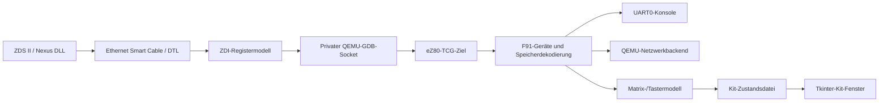

# Architektur

## Komponenten

Der kanonische Emulatorstand ist der Patch
`patches/0001-ez80f91-minimal.patch`. Er ergänzt einen separaten CPU-Kern und
ein F91-Gerätemodell auf der festgelegten QEMU-Basis. Der ignorierte Checkout
`qemu/` ist die lokale Entwicklungs-/Buildkopie, kein weiteres Root-Submodul.

## CPU

`target/ez80/` enthält CPU-Zustand, gemeinsamen Decoder, TCG-Anbindung,
Befehlshilfen und GDB-Registerabbildung. Ein Translation Block führt derzeit
einen dekodierten Gastbefehl aus. Die Befehlshelfer haben keine separate
CPU-Ausführungsschleife; Scheduling und virtuelle Zeit bleiben bei QEMU.

ADL, Präfixe und MBASE steuern 16-/24-Bit-Register-, Stack- und Adressbreiten.
Architektonische Werte bleiben trotz 32-Bit-Hostrepräsentation auf ihre
jeweiligen Breiten begrenzt. Der Decoder berücksichtigt Adress-Wrapping und
Moduswechsel. Nicht unterstützte Befehle werden diagnostiziert bzw. lösen
für die implementierten Fälle den F91-TRAP aus.

## SoC und Board

`hw/ez80/` enthält getrennte Modelle für Speicher/Flash, UART, Interrupts,
Timer, Takt/PLL, RTC und EMAC. Die Maschinen `ez80f91-minimal` und
`ez80f91-freertos` verwenden unterschiedliche Startprofile derselben Geräte.
Das RAM-Bootprofil erlaubt den Original-Boardstart aus SRAM.

CS0–CS3 schalten externe RAM-/AMD-Flash-Bänke dynamisch. Interner Speicher
und höher priorisierte Chip Selects behalten Vorrang. Das Kit wird nur mit
aktivierter Zustandsdatei und passendem CS2-Fenster bei 800000h eingeblendet.
[Speicher](chip-selects.md) und [Kit](kit.md) enthalten die Registerdetails.

Flash-Persistenz speichert den Inhalt pro Debugport im Arbeitsverzeichnis.
Das sind Nutzdaten, keine Buildprodukte. Tests verwenden dafür eigene
Temporärverzeichnisse.

## Debugging und Netzwerk

`--dbgport` startet die Python-Brücke mit einem privaten GDB-Unixsocket.
Die originalen ZDS-EthernetSC-Kommandos werden über DTL/ZDI auf QEMU-Zustand
abgebildet. Die Helperdateien unter `tools/zds/` und ihre Bundlekopien in
QEMU müssen identisch sein; `test_dbgport.py` prüft diese Voraussetzung.

Der Debuggerkanal ist unabhängig vom Gast-MAC. DHCP/TCP/IP laufen in der
Gastfirmware über das gewählte QEMU-Netzwerkbackend, beim Standardstarter
über `br0`. Die Verbindung zum Debugger verwendet die Host-IP.

## Anzeige und Zeitmodell

Die Matrix wird aus echten Gastzugriffen auf die beiden Board-Latches
rekonstruiert. Die Anzeigelogik sammelt alle sieben Zeilen und veröffentlicht
vollständige Scans. Sie verlangt keine identischen Folgeframes, damit
Laufschrift in jedem Durchlauf weiterlaufen kann. Das Tkinter-Fenster liest
abgeschlossene Pixelmasken und die unabhängig aktualisierten Taster-/Registerwerte.

CPU-Ausführung, Gerätetimer und Matrix-Leuchtzeiten verwenden Gastzeit;
das Fenster wird in Hostzeit abgefragt. `-icount` unterstützt reproduzierbare
Tests, ersetzt aber keine korrekten eZ80-Befehlslaufzeiten. Elektrische
Signalverläufe, analoge PLL-Effekte und exaktes Baudtiming sind nicht modelliert.

## Firmware und Nachweise

Test-ROMs, gespeicherte Firmware-Images und Metadaten befinden sich unter
`examples/`. Die Tests prüfen UART, Speicher, Register, IRQs und Reset über
QMP/GDB. SDK- und Live-Netzwerkprüfungen sind getrennt gekennzeichnet.
[Status](status.md), [Testkatalog](testing.md) und [Quellen](sources.md)
benennen den geprüften Umfang und die verbleibenden Grenzen.
