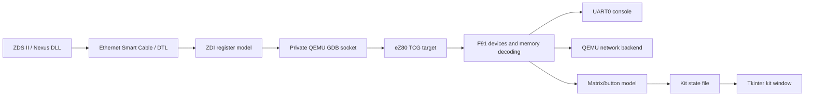

# Architecture

## Components

The authoritative emulator changes are in `patches/0001-ez80f91-minimal.patch`,
which adds an independent CPU target and F91 devices to the pinned QEMU base.
The ignored `qemu/` directory is the local development/build copy, not another
root submodule.

## CPU

`target/ez80/` contains CPU state, shared decoding, TCG integration, instruction
helpers and GDB register mapping. Each translation block currently executes
one guest instruction. Helpers implement side effects without their own CPU
loop; QEMU retains scheduling and virtual-time control.

ADL, prefixes and MBASE select register, stack and address widths. Values
remain bounded to architectural widths despite 32-bit host storage. Decoding
handles address wrapping and mode changes. Unsupported encodings are diagnosed
or raise the implemented F91 TRAP.

## SoC and board

`hw/ez80/` separates memory/flash, UART, interrupts, timers, clock/PLL, RTC and
EMAC. `ez80f91-minimal` and `ez80f91-freertos` use different startup profiles
of these devices. RAM boot permits original board startup from SRAM.

CS0–CS3 dynamically map external RAM/AMD flash. Internal memory and higher
priority selects retain precedence. Kit latches appear at 800000h only with
an enabled state file and suitable CS2 window. See [Memory](chip-selects.md)
and [Kit](kit.md).

Flash persistence is per debug port and working directory. These files are
user data; tests use temporary directories.

## Debugging and networking

`--dbgport` launches the Python bridge using a private GDB Unix socket.
Original ZDS EthernetSC commands map through DTL/ZDI to QEMU state.
`tools/zds/` helpers and their QEMU bundle copies must match; `test_dbgport.py`
checks this.

The debugger channel is independent of guest Ethernet. Firmware runs DHCP/TCP/IP
over the selected backend, normally `br0` with the standard launcher.
The debugger uses the host's IP address; application services use the guest's.

## Display and time

The matrix is reconstructed from actual guest writes to board latches. Seven
completed rows form a published scan. Identical consecutive frames are not
required, allowing scrolling text to advance every scan. Tkinter reads complete
pixel masks while button/register state updates independently.

CPU execution, device timers and LED integration use guest time; the window
polls in host time. `-icount` supports repeatability, not accurate eZ80 cycle
timing. Electrical signals, analog PLL behavior and exact transmit baud timing
are not modeled.

## Firmware and evidence

`examples/` stores ROM sources, selected images and metadata. Tests inspect
UART, memory, registers, IRQs and reset through QMP/GDB. SDK-dependent and live
network checks are labeled separately. [Status](status.md), [Testing](testing.md)
and [Sources](sources.md) document coverage and remaining limits.
